# 血液细胞与 L1000 扰动谱的 Lasso 分析报告

日期：2026-10-26（Asia/Shanghai）。四部分分析均已完成；原始数据未修改。

## 一、质控与预处理

| 数据 | 原行数 | 列数 | 唯一基因数 | 重复行数 | 缺失 | 无穷值 | 最小值 | 最大值 |
| --- | --- | --- | --- | --- | --- | --- | --- | --- |
| blood | 20001 | 22 | 19994 | 7 | 0 | 0 | 0.000 | 8.778 |
| L1000 | 12328 | 2717 | 12327 | 1 | 0 | 0 | -10.000 | 10.000 |

血液数据删除 7 个重复行（涉及 MATR3、MKKS、HERC3、POLR2J3、NPIPA9、PINX1），L1000 删除 1 个重复行（MIA2）；均保留原文件第一次出现。两套数据均无缺失值和无穷值。血液基因包含 580 个 Ensembl 格式标识，L1000 为符号格式；这些 Ensembl 行未精确匹配到 L1000，本次未推断其符号映射。该损失已记录，后续可在核实版本后映射。

按共同标识和相同顺序对齐后，共有 11,940 个基因、2,717 个扰动，其中 286 个扰动匹配 Lambert 人类 TF 名单。没有零方差扰动被剔除。血液表达范围 0–8.778474；其完整归一化来源未知，主分析采用提供尺度，不再盲目取对数。L1000 范围约 −10–10，作为有符号扰动特征使用，不取对数，也不将其声称为已核实的原始 log-fold change。

髓系树突细胞约 94.0% 的基因表达为零，保留分析但标注为低信息目标。零值不作为缺失值填补。缺少原始计数与细胞/供体重复，因此不重新进行计数归一化，也不做不适用的差异表达显著性检验。

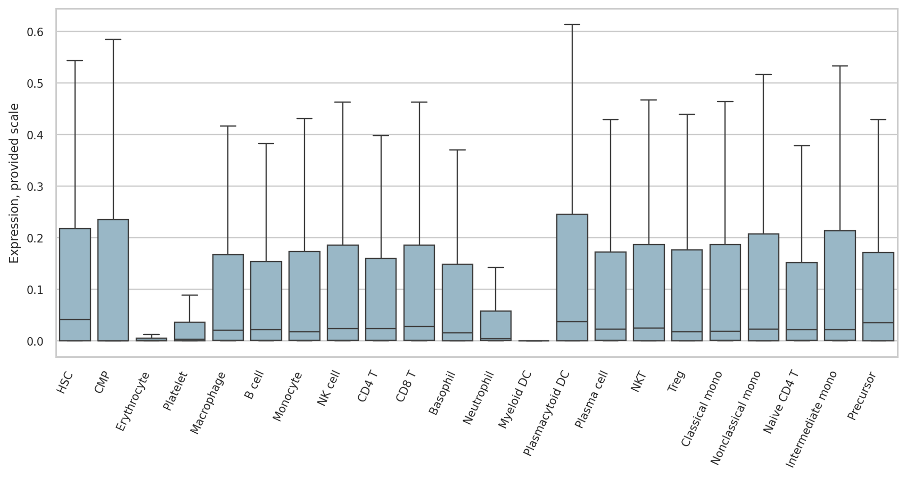

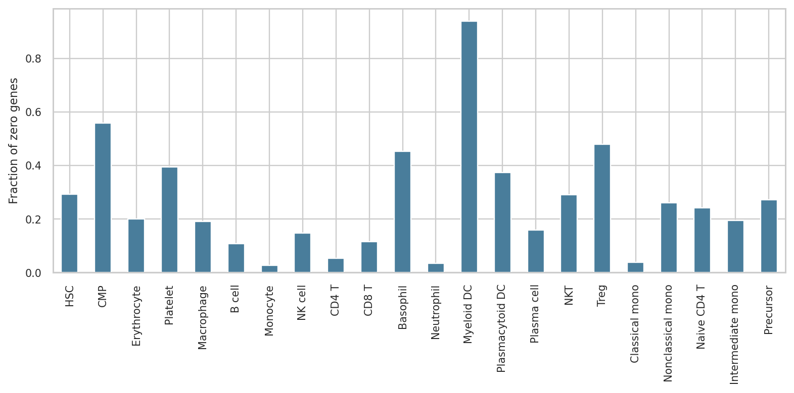

## 二、血液细胞探索性分析

高变基因热图选取方差最大的 60 个基因，逐基因跨细胞 z 标准化，Ward/欧氏距离双向聚类。高变基因中核糖体基因较多，反映整体表达差异，不能仅据此解释谱系；另补充预先指定的血液谱系标记热图。PCA 和细胞聚类使用 2,000 个高变基因，5 类仅用于探索，不声称是最优分类数。

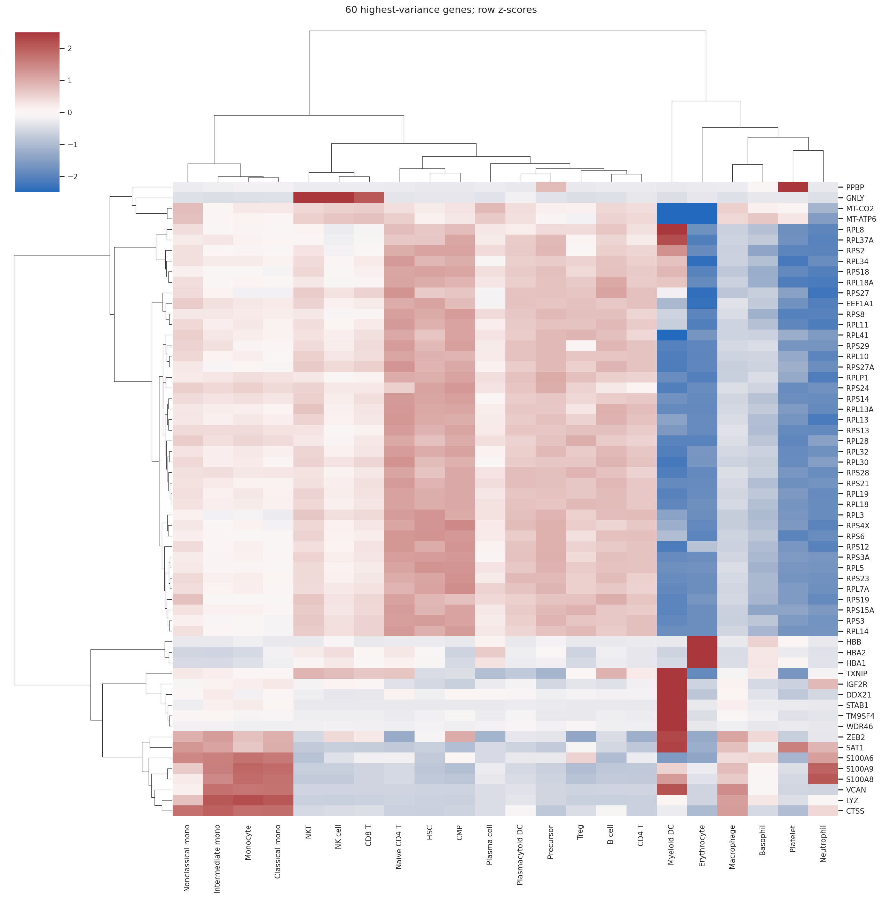

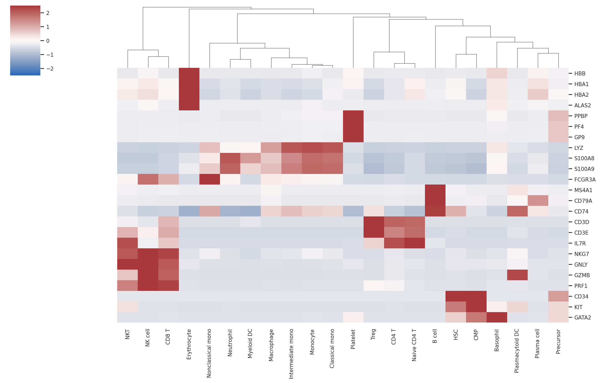

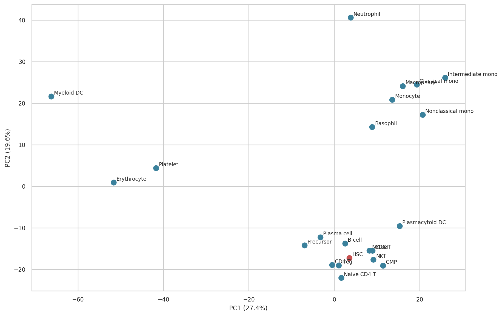

聚类 1：Erythrocyte；Platelet。

聚类 2：Myeloid DC。

聚类 3：Macrophage；Monocyte；Basophil；Neutrophil；Classical mono；Nonclassical mono；Intermediate mono。

聚类 4：NK cell；CD4 T；CD8 T；NKT；Treg；Naive CD4 T。

聚类 5：HSC；CMP；B cell；Plasmacytoid DC；Plasma cell；Precursor。

红细胞/血小板、T/NK、单核/髓系细胞呈现谱系相关的聚集；HSC、祖细胞及若干 B/树突细胞则在当前表示下聚到同一组，提示这不是纯粹的谱系树。髓系树突细胞单独成簇可能同时受高零比例影响。PCA 前两轴解释比例为 27.4% 和 19.6%。全部相关性见 eda/cell_spearman_correlations.csv。

## 三、Lasso 建模与预测评价

对其余 21 种细胞分别构建 y = 目标细胞表达 − HSC 表达，X 为共同基因 × 全部 L1000 扰动。目标函数为 (1/2n)||y−截距−Xβ||² + α||β||₁。模型使用训练集内拟合的扰动列标准化与响应标准化，系数表保留符号、标准化系数及原始单位系数。

共同基因固定随机划分为 9,552 个训练基因和 2,388 个测试基因。训练集内 3 折交叉验证搜索 24 个相对 alpha，采用 1 标准误规则偏向稀疏模型。测试集不调参，候选来自训练集模型，未用测试基因重新拟合。最终数值收敛检查通过，所有拟合最多使用 1175 次迭代。该矩阵 p<n，属于多特征稀疏回归，非严格的 p>n。

| 目标 | 测试R² | 测试RMSE | 测试Pearson | 非零扰动数 | 非零TF数 |
| --- | --- | --- | --- | --- | --- |
| CMP | 0.071 | 0.161 | 0.277 | 98 | 12 |
| Erythrocyte | 0.621 | 0.233 | 0.788 | 572 | 55 |
| Platelet | 0.410 | 0.327 | 0.641 | 581 | 67 |
| Macrophage | 0.548 | 0.194 | 0.741 | 762 | 84 |
| B cell | 0.430 | 0.160 | 0.657 | 707 | 80 |
| Monocyte | 0.469 | 0.195 | 0.686 | 683 | 85 |
| NK cell | 0.456 | 0.170 | 0.677 | 760 | 87 |
| CD4 T | 0.429 | 0.134 | 0.656 | 763 | 80 |
| CD8 T | 0.465 | 0.159 | 0.682 | 747 | 82 |
| Basophil | 0.421 | 0.242 | 0.650 | 416 | 56 |
| Neutrophil | 0.594 | 0.272 | 0.771 | 672 | 84 |
| Myeloid DC | 0.190 | 0.465 | 0.445 | 233 | 30 |
| Plasmacytoid DC | 0.394 | 0.148 | 0.629 | 787 | 79 |
| Plasma cell | 0.411 | 0.158 | 0.642 | 691 | 67 |
| NKT | 0.368 | 0.166 | 0.607 | 648 | 73 |
| Treg | 0.367 | 0.181 | 0.607 | 766 | 82 |
| Classical mono | 0.478 | 0.201 | 0.692 | 678 | 80 |
| Nonclassical mono | 0.470 | 0.192 | 0.686 | 858 | 97 |
| Naive CD4 T | 0.353 | 0.148 | 0.595 | 704 | 75 |
| Intermediate mono | 0.495 | 0.206 | 0.704 | 751 | 88 |
| Precursor | 0.261 | 0.088 | 0.511 | 393 | 49 |

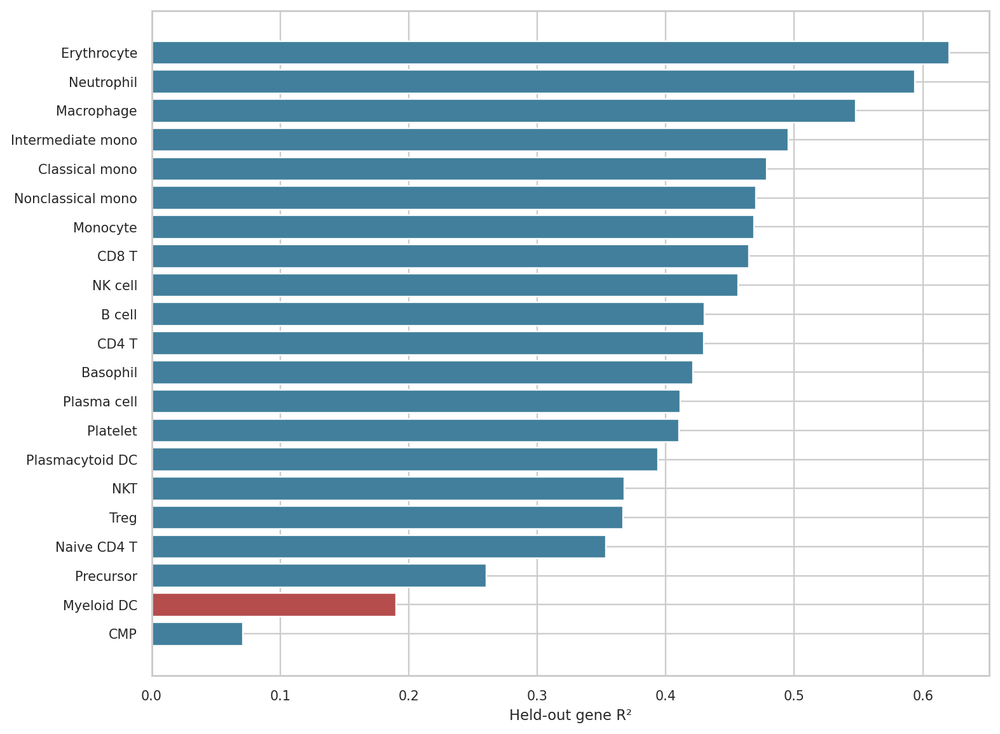

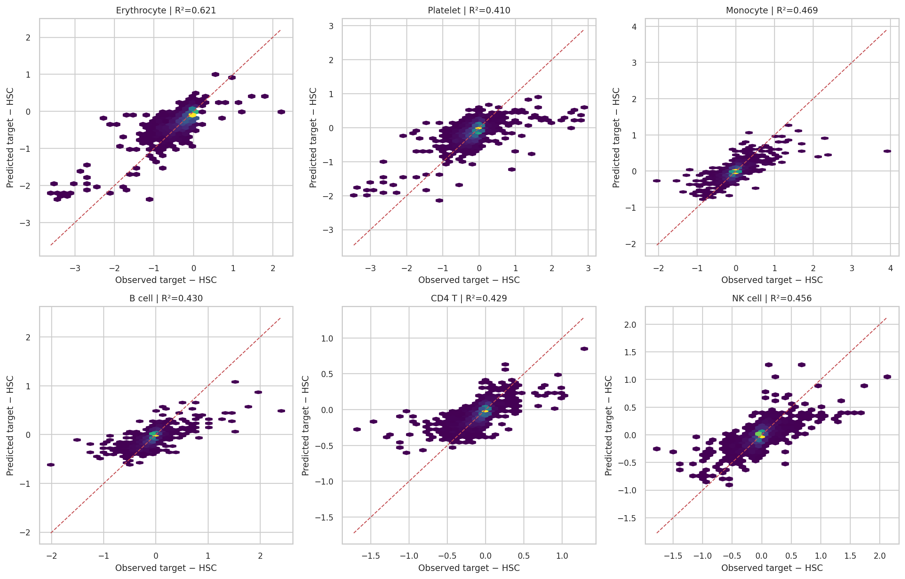

全部模型优于训练均值基线，测试 R² 范围 0.071–0.621；红细胞和中性粒细胞较高，共同髓系祖细胞较低。六个代表目标的单次训练响应打乱对照测试 R² 均为负（-0.164 至 -0.091），仅说明打乱后失去匹配能力，不是正式显著性检验。

CV 路径中有 7 个目标的最小验证 MSE 位于最弱惩罚边界；已明确记录，后续可扩大搜索范围。主模型均按事先规定的 1SE 规则选取，未根据测试表现挑选 alpha。

## 四、候选扰动、TF 与跨细胞比较

全部扰动按 |标准化系数| 排序；只有匹配 Lambert 1,639 人类 TF 名单的候选进入 TF 表。RIOK2、DNMT3A、HDAC1、HMGB1、PML 等可作为其他调控扰动讨论，但不在本报告中误称为严格 TF。正系数表示联合拟合中的同向加权，负系数表示反向加权，不等价于已验证的过表达/敲除实验效果。

以下为六个代表目标各自按绝对系数排名前五的 TF，括号为带符号标准化系数：

红细胞：MYB (+0.073)，IRF3 (+0.059)，ELK3 (+0.058)，PREB (+0.057)，NFYB (-0.052)。

血小板：KLF6 (+0.081)，SMAD3 (+0.054)，HNF4A (+0.052)，ATMIN (-0.052)，CREB5 (+0.042)。

单核细胞：PAX8 (+0.100)，KLF6 (+0.079)，OVOL2 (+0.071)，SIM2 (-0.069)，TFAP2A (+0.066)。

B细胞：ZNF22 (+0.052)，NFYB (-0.046)，ZNF449 (+0.043)，RORC (+0.042)，ZNF174 (-0.041)。

CD4 T细胞：OVOL2 (+0.116)，TCF4 (+0.080)，NFYB (-0.063)，KLF6 (+0.053)，ZNF32 (-0.049)。

NK细胞：OVOL2 (+0.120)，NFYB (-0.060)，ZNF195 (-0.050)，EGR1 (+0.047)，ZNF583 (+0.045)。

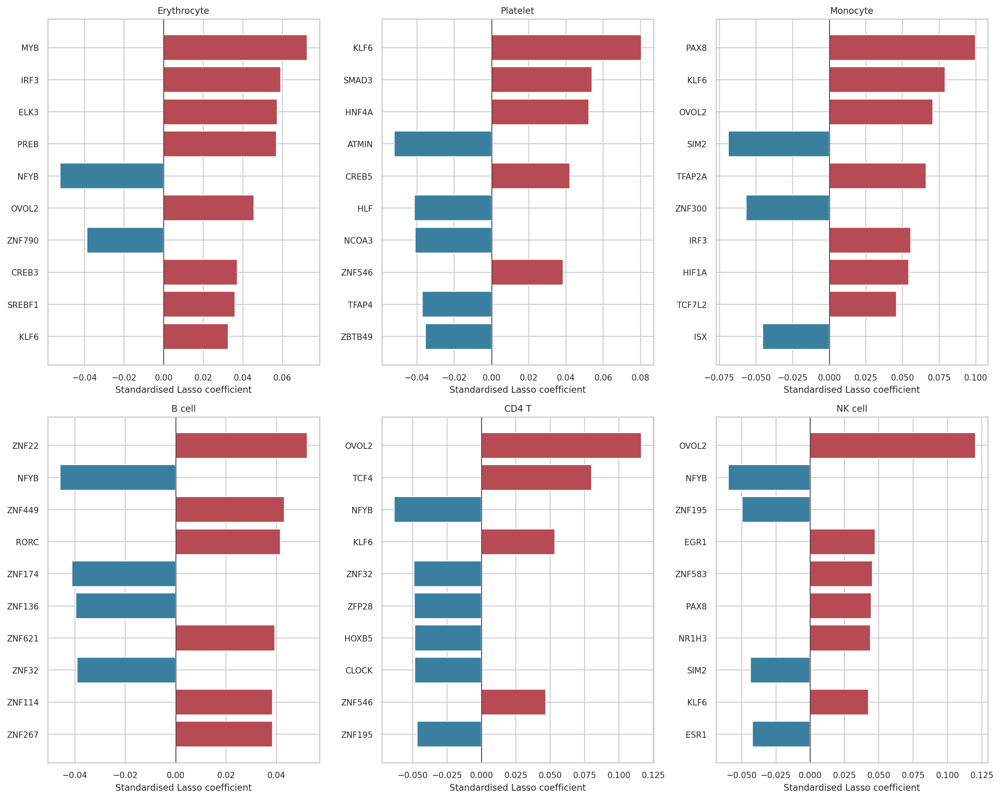

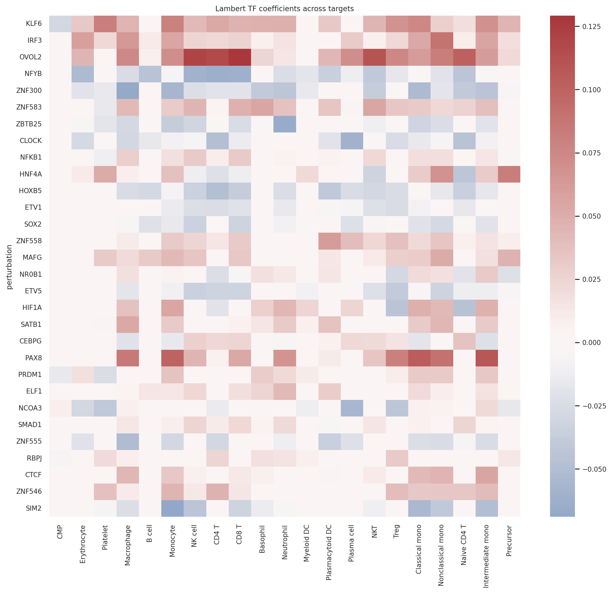

| 目标 | 代表TF | 标准化系数 | 5次入选频率 | 训练边际相关 | 测试边际相关 |
| --- | --- | --- | --- | --- | --- |
| 红细胞 | MYB | 0.073 | 1.000 | 0.312 | 0.350 |
| 血小板 | KLF6 | 0.081 | 1.000 | 0.183 | 0.177 |
| 单核细胞 | PAX8 | 0.100 | 1.000 | 0.131 | 0.110 |
| B细胞 | RORC | 0.042 | 1.000 | 0.138 | 0.135 |
| CD4 T细胞 | OVOL2 | 0.116 | 1.000 | 0.159 | 0.147 |
| NK细胞 | OVOL2 | 0.120 | 1.000 | 0.180 | 0.163 |

代表 TF 优先选择正系数、正训练边际相关且入选频率至少 60% 的最强候选；不使用测试相关选择候选。上表和图中，单个 TF 的测试相关通常明显低于联合模型的预测相关，说明这些候选只覆盖差异的一部分。五次入选不等于高置信因果证据，也不构成稳定性选择的错误率保证。

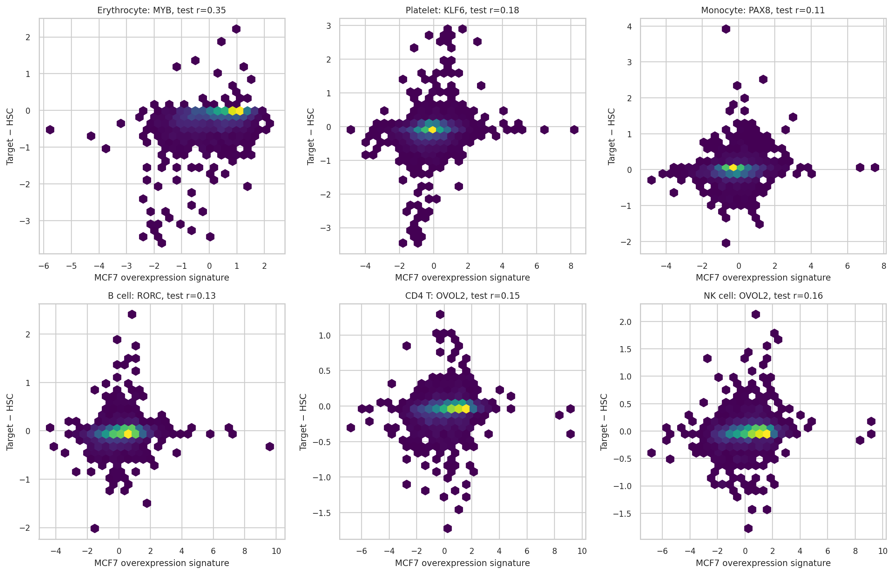

跨细胞比较使用每个目标前 10 个非零 TF 的 Jaccard：

| cell_a | cell_b | n_shared | Jaccard | shared_TFs |
| --- | --- | --- | --- | --- |
| Monocyte | Classical mono | 10 | 1.000 | HIF1A;IRF3;ISX;KLF6;OVOL2;PAX8;SIM2;TCF7L2;TFAP2A;ZNF300 |
| Monocyte | Intermediate mono | 9 | 0.818 | HIF1A;IRF3;ISX;KLF6;OVOL2;PAX8;SIM2;TCF7L2;TFAP2A |
| Classical mono | Intermediate mono | 9 | 0.818 | HIF1A;IRF3;ISX;KLF6;OVOL2;PAX8;SIM2;TCF7L2;TFAP2A |
| NK cell | CD8 T | 7 | 0.538 | KLF6;NFYB;NR1H3;OVOL2;PAX8;ZNF195;ZNF583 |
| Macrophage | Monocyte | 7 | 0.538 | IRF3;ISX;KLF6;OVOL2;PAX8;TFAP2A;ZNF300 |
| Macrophage | Classical mono | 7 | 0.538 | IRF3;ISX;KLF6;OVOL2;PAX8;TFAP2A;ZNF300 |
| Macrophage | Intermediate mono | 6 | 0.429 | IRF3;ISX;KLF6;OVOL2;PAX8;TFAP2A |
| Nonclassical mono | Intermediate mono | 6 | 0.429 | CTCF;IRF3;OVOL2;PAX8;TCF7L2;TFAP2A |

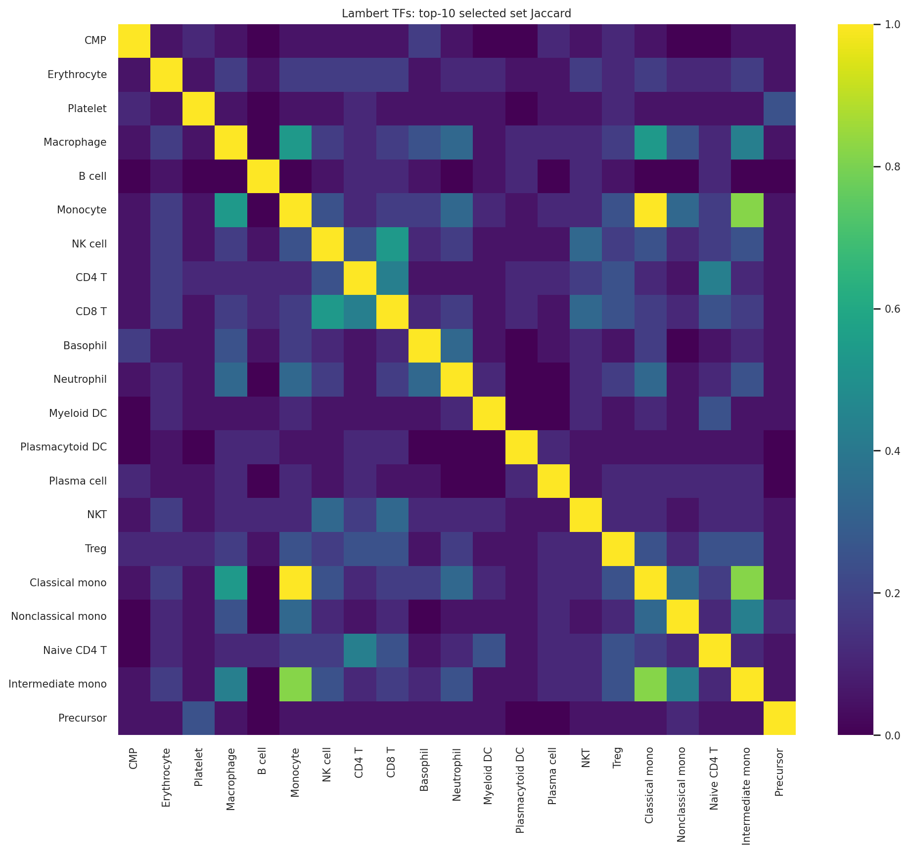

谱系相近目标通常共享更多候选，尤其单核细胞及其亚型。也存在跨谱系共享，可能来自普遍转录程序或共同的 HSC 参照，不应直接解释为谱系特异因果调控。集合重叠不考虑符号，需结合带符号的系数矩阵查看同向或反向。

## 稳定性、预处理敏感性与解释边界

扰动库的覆盖范围也是关键限制：GATA2、MYB 有对应扰动列，但 GATA1、SPI1、CEBPA、RUNX1、TAL1、KLF1、PAX5、BCL11A、TCF7 在此文件中没有对应扰动列。它们作为响应基因出现不等于存在相应干预。模型无法选出未被提供的扰动，不能把这些经典造血 TF 未入选解释为其不重要。详细覆盖表见 qc/canonical_TF_coverage.csv。

五次训练基因 80% 子抽样已完成，全部候选的入选和同符号频率已保存。额外 log1p 后，入选扰动集合 Jaccard 范围为 0.511–0.774，前 20 扰动重叠为 8–16 个，说明预处理会改变部分候选，不能把单一排序视为唯一结果。此敏感性模型复用相对 alpha、未重新调参，R² 对应不同响应尺度，不用于宣称取对数后的性能必然更优。

本分析是 MCF7 扰动特征与血液细胞平均表达差异的统计匹配，不证明 MCF7 中的扰动在血液背景中同样有效。PAX8、OVOL2 等候选即使排名较高，也需警惕组织背景或共线性的影响，不能直接称为血液分化主调控因子。优先核实候选 TF 在目标细胞的表达、相关文献及独立血液扰动证据，再考虑过表达、敲低及组合干预。

基因不是独立生物学重复；随机留出基因的 R² 仅评价当前平均谱上的差异重建，不能外推为新供体预测准确率、分化成功率或实验因果效果。基因间共表达可能让随机划分偏乐观。建议用独立供体数据、按共表达模块/通路划分基因的验证，以及血液细胞背景的扰动实验检验候选。现有数据不能估计供体间变异或计算适当的差异表达 p 值。

## 文件与方法来源

完整质控见 qc/；探索数据见 eda/；全候选、TF 排名、测试指标、逐基因预测、稳定性和敏感性见 models/；图像为 figures/ 下的 PNG/PDF。README.md 记录全部参数，metadata.json 保存输入校验和与依赖版本。

TF 来源：Lambert SA et al. The Human Transcription Factors. Cell. 2018;172:650–665. doi:10.1016/j.cell.2018.01.029；PMID 29425488。名单 v1.01 的固定 GitHub 镜像及 SHA256 见 metadata.json。没有将示例 notebook 中训练集分数当作交叉验证分数。
